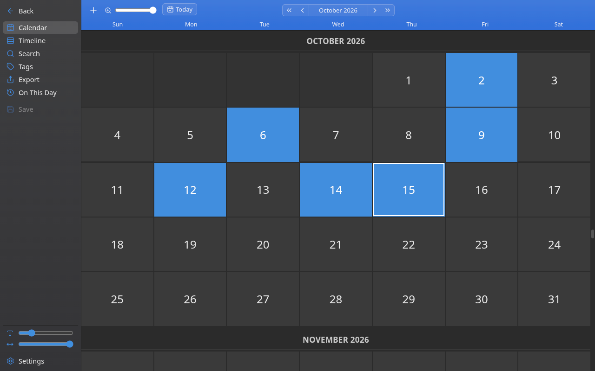
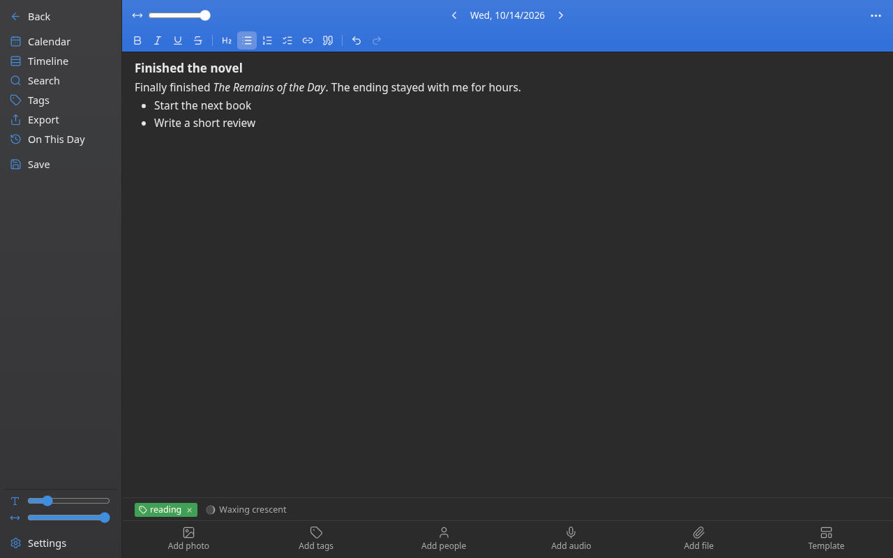
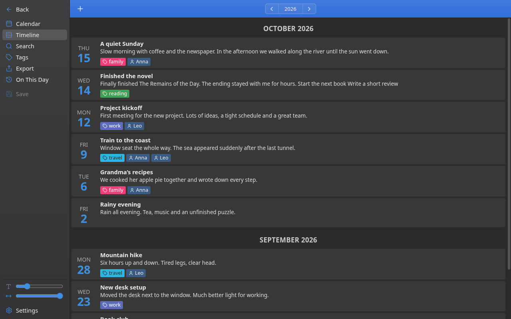
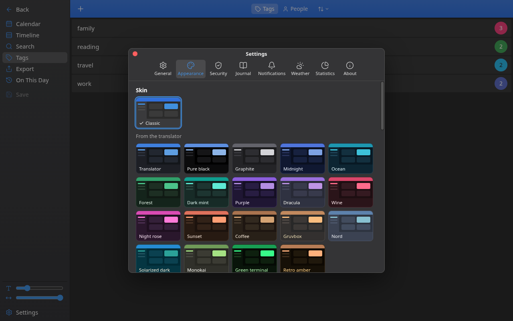

# diarLinux

**An encrypted personal journal for Linux**, inspired by Diarium. Everything stays on your computer, encrypted with your password. The interface is in English and Spanish.

*[Español más abajo](#español)*



| Writing | Timeline | Appearance |
|---|---|---|
|  |  |  |

## Features

- **Calendar, timeline, search and “On This Day”** views of your journal.
- **Rich-text entries**: headings, lists, checklists, links, quotes.
- **Attachments**: photos, videos, audio (record from the microphone or add files) and any other file.
- **Tags and people**, with colors, merging and filtering.
- **Weather** for each entry (from [Open-Meteo](https://open-meteo.com/), no account needed), plus the moon phase, sunrise and sunset.
- **Templates** for new entries, a word counter and per-entry word goals.
- **Export** to Word (.docx), PDF, HTML, Markdown, plain text or JSON.
- **Import** from Diarium (JSON .zip) and Joplin (JEX or RAW folder).
- **47 skins** and dozens of accent colors, adjustable background brightness and warmth, and font options.
- **Automatic encrypted backups**, a daily reminder and a system tray icon.
- **English and Spanish**: it follows your system language and can be changed in Settings.

## Security

- The journal text is stored in an **SQLCipher**-encrypted database; attachments are encrypted with **AES-256-GCM** in chunks.
- A random data key is protected by your password (**Argon2id**) and by a **recovery code** shown once when you create the journal.
- Nothing is sent anywhere, except the city coordinates and date when you ask for the weather.
- If you lose both the password and the recovery code, the journal **cannot** be recovered.

## Install

Download from the [Releases](https://github.com/RutaInfinitax/diarLinux/releases) page:

- **Arch / CachyOS / Manjaro**: `sudo pacman -U diarLinux-<version>.pacman`
- **Any distribution**: make the `.AppImage` executable and run it.

## Build from source

Requires Node.js 22+.

```bash
npm install
npm run build:linux     # AppImage and pacman package in dist/
./iniciar.sh            # or run it directly from the source
```

Tests: `npm test` (unit) and the `scripts/e2e-*.mjs` end-to-end suites.

## License

[MIT](LICENSE). It bundles open-source libraries (Electron, React, TipTap, SQLite/SQLCipher, hash-wasm, DOMPurify, Lucide…); their licenses are listed in Settings → About.

---

## Español

**Diario personal cifrado para Linux**, inspirado en Diarium. Todo queda en tu computadora, cifrado con tu contraseña. La interfaz está en español y en inglés.

### Funciones

- Vistas de **calendario, línea de tiempo, búsqueda y «En este día»**.
- **Entradas con formato**: encabezados, listas, tareas, enlaces y citas.
- **Adjuntos**: fotos, videos, audios (grabados con el micrófono o desde archivos) y cualquier otro archivo.
- **Etiquetas y personas**, con colores, fusión y filtros.
- **Clima** en cada entrada (de [Open-Meteo](https://open-meteo.com/), sin cuenta), fase lunar, amanecer y atardecer.
- **Plantillas**, contador de palabras y objetivo por entrada.
- **Exportar** a Word, PDF, HTML, Markdown, texto o JSON. **Importar** desde Diarium y Joplin.
- **47 skins**, decenas de colores de acento y ajustes de fondo y letra.
- **Backups cifrados automáticos**, recordatorio diario e ícono en la bandeja.
- **Español e inglés**: sigue el idioma del sistema y se puede cambiar en Configuración.

### Seguridad

El texto va en una base de datos cifrada con **SQLCipher** y los adjuntos con **AES-256-GCM**. La llave se protege con tu contraseña (**Argon2id**) y con un **código de recuperación** que se muestra una sola vez. Si pierdes la contraseña y el código, el diario **no** se puede recuperar.

### Instalar

Desde [Releases](https://github.com/RutaInfinitax/diarLinux/releases): `sudo pacman -U diarLinux-<versión>.pacman` en Arch/CachyOS, o el `.AppImage` en cualquier distribución.

### Licencia

[MIT](LICENSE).
